<a href="https://github.com/bazalamatyas"><picture><source media="(prefers-color-scheme: dark)" srcset="cards/dark/hero.svg"></picture></a>

<a href="https://github.com/bazalamatyas?tab=repositories"><picture><source media="(prefers-color-scheme: dark)" srcset="cards/dark/tile-build.svg"></picture></a>
<a href="#user-content-activity"><picture><source media="(prefers-color-scheme: dark)" srcset="cards/dark/tile-ship.svg"></picture></a>
<a href="#user-content-projects"><picture><source media="(prefers-color-scheme: dark)" srcset="cards/dark/tile-web.svg"></picture></a>

### Activity

<picture><source media="(prefers-color-scheme: dark)" srcset="cards/dark/activity.svg"></picture>

### Projects

<picture><source media="(prefers-color-scheme: dark)" srcset="cards/dark/project-apis.svg"></picture>
<picture><source media="(prefers-color-scheme: dark)" srcset="cards/dark/project-webapps.svg"></picture>
<picture><source media="(prefers-color-scheme: dark)" srcset="cards/dark/project-websites.svg"></picture>
<picture><source media="(prefers-color-scheme: dark)" srcset="cards/dark/project-languages.svg"></picture>

<picture><source media="(prefers-color-scheme: dark)" srcset="cards/dark/heatmap.svg"></picture>

Reach me: <a href="mailto:11matybazala@gmail.com">11matybazala@gmail.com</a> · <a href="https://www.linkedin.com/in/maty%C3%A1%C5%A1-bazala-1457092b1">LinkedIn</a>
